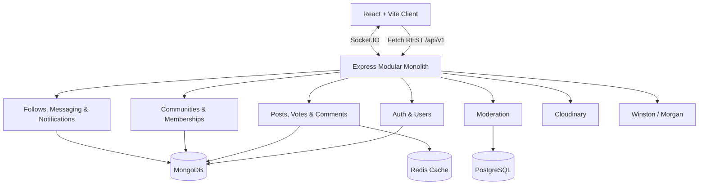

# UNFOLD — Final Technical Blueprint & Integration Contracts

**Project:** Unfold — Community-Driven Social Media Platform  
**Course:** Back End Engineering-II (24CSE0315), Chitkara University  
**Team size:** 3  
**Version:** 1.2 — Architecture and two-upvote policy locked 24 November 2026

---

> **v1.2 decision update:** The publishing gate is two distinct upvotes on the user's latest published post for every post after the first. Downvotes affect the visible net score only; there is no additional net-score threshold. The rule applies globally across General and community posts.

## 1. Locked technology decisions

| Layer | Selected technology | Responsibility |
|---|---|---|
| Frontend | React + Vite + JavaScript | Responsive single-page application |
| Styling | Bootstrap 5 + custom CSS variables | Shared Peachy Community design system, light/dark themes |
| Routing | React Router | Client-side routing and protected pages |
| API client | Fetch API | REST API calls with `credentials: include` |
| Backend | Node.js + Express | Modular REST API |
| Primary database | MongoDB + Mongoose | Users, posts, comments, votes, communities, memberships, follows, messages and notifications |
| Relational database | PostgreSQL + `pg` | Moderation reports and moderation audit records |
| Authentication | JWT in HttpOnly cookie + bcrypt | Username/password authentication and protected APIs |
| File upload | Multer memory storage | Receive and validate media uploads |
| Media storage | Cloudinary | Store image and audio assets; optional video support |
| Real-time | Socket.IO | Live messages, notifications, typing indicators and read receipts |
| Cache | Redis | Cache trending communities and public feed queries |
| Logging | Morgan + Winston | HTTP request logs and structured application logs |
| Validation | Zod | Validate request bodies, query strings and parameters |
| API verification | Documented endpoint contracts and acceptance criteria | Maintain consistent request/response behaviour |
| Backend tests | Jest + Supertest | Service/API tests |
| API documentation | Swagger / OpenAPI | Document REST endpoints |
| Containers | Docker + Docker Compose | Reproducible local development environment |
| CI/CD | GitHub Actions | Lint, test and build checks on pull requests/pushes |

**Architecture decision:** Use one Express API server with feature modules. Do not create separate backend servers for each team member. MongoDB is the system of record for social data. PostgreSQL is the system of record for moderation records. Redis is a cache, not a source of truth.


### 1.1 Suggested package dependencies

Keep the dependency set lean. Install only what is actually used by the implementation.

**Frontend foundation:** `react`, `react-dom`, `vite`, `bootstrap`. Use the existing Fetch wrapper in `client/src/services/api.js`. Add `socket.io-client` only when the real-time module is integrated.

**Backend runtime:** `express`, `mongoose`, `pg`, `redis`, `socket.io`, `bcryptjs`, `jsonwebtoken`, `cors`, `helmet`, `express-rate-limit`, `multer`, `cloudinary`, `zod`, `morgan`, `winston`, `dotenv`, `swagger-jsdoc`, `swagger-ui-express`.

**Development/testing (target set):** Jest, Supertest, ESLint and the selected formatter. The current foundation policy tests use Node.js directly; add Jest/Supertest when endpoint integration tests are introduced. `mongodb-memory-server` may be used for isolated tests, but integration tests should also run against the Docker/Atlas-compatible Mongo configuration.

Do not add a second form library, CSS framework, state-management library or HTTP client without team agreement.

## 2. Product scope

### 2.1 MVP features

1. Registration with server-generated random username and user-selected password.
2. Login using username and password; logout and authenticated session lookup.
3. User profile, avatar, bio, followers and following.
4. Create and explore communities; join and leave communities.
5. General feed and community-specific feeds.
6. Create text, image and audio posts. Video is optional for the first evaluation build.
7. Comments on published posts.
8. One upvote or downvote per user per post, with the ability to change the vote.
9. Reputation-based publishing gate and private pending posts.
10. One-to-one direct messages.
11. Notifications for follows, comments, votes and messages.
12. Report content and a role-protected moderation dashboard.
13. Light and dark UI themes.

### 2.2 Explicitly out of scope for the first working prototype

- Recommendation/ML ranking engine.
- Group chats and voice/video calls.
- OAuth/social login.
- Microservices split or API gateway deployment.
- Advanced video transcoding.
- Automated AI content moderation.

These can be documented as future scope. They must not delay the working MVP.

## 3. Architecture



### 3.1 Request lifecycle

1. React sends a Fetch request to `/api/v1` with `credentials: "include"`.
2. Express applies CORS, Helmet, request logging, cookie parsing and JSON parsing.
3. Route-level middleware validates the request and verifies authentication/role where required.
4. Controller handles HTTP input/output only.
5. Service implements business rules and coordinates models/database operations.
6. Model/repository reads or writes MongoDB/PostgreSQL.
7. The API returns the standard JSON envelope.
8. For real-time events, the service emits through the shared Socket.IO service after a successful write.

### 3.2 Repository structure

```text
unfold/
├── client/
│   ├── src/
│   │   ├── app/                  # App, router, providers
│   │   ├── assets/
│   │   ├── components/           # Shared UI only
│   │   ├── layouts/
│   │   ├── features/
│   │   │   ├── auth/
│   │   │   ├── profile/
│   │   │   ├── feed/
│   │   │   ├── posts/
│   │   │   ├── communities/
│   │   │   ├── social/
│   │   │   ├── messages/
│   │   │   ├── notifications/
│   │   │   └── moderation/
│   │   ├── services/              # Shared Fetch API wrapper + API helpers
│   │   ├── context/               # AuthContext, ThemeContext
│   │   ├── hooks/
│   │   ├── styles/
│   │   └── main.jsx
│   └── package.json
├── server/
│   ├── src/
│   │   ├── config/                # Mongo, PostgreSQL, Redis, Cloudinary, env
│   │   ├── middleware/            # auth, roles, validation, errors, rate limits
│   │   ├── shared/                # ApiError, response, asyncHandler, constants
│   │   ├── modules/
│   │   │   ├── auth/
│   │   │   ├── users/
│   │   │   ├── posts/
│   │   │   ├── comments/
│   │   │   ├── votes/
│   │   │   ├── media/
│   │   │   ├── communities/
│   │   │   ├── memberships/
│   │   │   ├── follows/
│   │   │   ├── messaging/
│   │   │   ├── notifications/
│   │   │   └── moderation/
│   │   ├── sockets/                # Socket.IO setup and event handlers
│   │   ├── jobs/                   # Optional scheduled cleanup jobs
│   │   ├── app.js
│   │   └── server.js
│   ├── tests/
│   └── package.json
├── docs/                           # API, architecture, schema, test evidence
├── .github/workflows/ci.yml
├── docker-compose.yml
├── Dockerfile                      # API image; client may have its own Dockerfile
├── .env.example
├── README.md
└── package.json                    # Optional npm workspaces
```

**Rule:** A module owns its own routes, controller, service, model/schema and validator. Shared infrastructure belongs to Person 1. Do not flatten all files into shared top-level folders where different agents overwrite one another.

## 4. Team ownership and module boundaries

### Person 1 — Project lead, authentication and platform infrastructure

**Owns:**
- Shared repository conventions and integration decisions.
- MongoDB, PostgreSQL and Redis connection configuration.
- User model and authentication module.
- Registration, generated username, login, logout and `/auth/me`.
- User profile update and role middleware.
- Shared `ApiError`, `asyncHandler`, response helper and error middleware.
- Shared Fetch API wrapper, AuthContext/ThemeContext as needed, app shell, navbar/sidebar and shared UI primitives.
- Cloudinary configuration contract, `.env.example`, CORS/security baseline.
- Winston/Morgan, Docker Compose, GitHub Actions and final integration.
- PostgreSQL moderation module schema/connection, with report UI/API integration coordinated with Person 3.

**Must not own:** post/vote/comment implementation, community membership business logic or messaging implementation.

### Person 2 — Content, publishing and reputation

**Owns:**
- Post model/service/controller/routes.
- Media upload endpoints using Multer and Cloudinary integration helper.
- Post creation/edit/delete, public feed and pagination.
- Comments.
- Votes and score updates.
- Reputation gate and pending-post auto-promotion.
- Feed and post frontend screens, post composer, media preview, vote controls and comments UI.

**Must not own:** User model/authentication, shared UI tokens, community membership model or global app shell.

### Person 3 — Communities and social graph

**Owns:**
- Community and Membership models/services/routes.
- Community create/explore/join/leave and community frontend.
- Follow/unfollow and follower/following lists.
- Conversation and Message models/services/routes.
- Socket.IO client/server event integration for messages and notifications.
- Notification model/service/UI.
- Report submission and moderation dashboard UI, integrating with Person 1's PostgreSQL schema/API.

**Must not own:** User model/authentication, Post model, shared UI tokens or global app shell.

### 4.1 Cross-module service contracts

These shared functions must have stable names and payloads. Each owner implements the function in their module; other modules import it rather than duplicating logic.

```js
// Auth middleware (Person 1)
req.user = { id: string, username: string, role: 'user' | 'moderator' | 'admin' };
requireAuth(req, res, next);
requireRole('moderator', 'admin');

// Membership service (Person 3; consumed by Person 2)
await membershipService.assertActiveMember({ userId, communityId });
// Throws 403 if the user is not an active member.

// Notification service (Person 3; consumed by Persons 1 and 2)
await notificationService.createNotification({
  recipientId, actorId, type, entityType, entityId, metadata = {}
});
// Persists notification and emits `notification:new` to recipient's socket room.

// Reputation service (Person 2)
await reputationService.evaluatePendingPost({ authorId });
// Checks the latest published post's eligibility and promotes the author's sole pending post if eligible.

// Socket service (Person 3; shared import)
socketService.emitToUser(userId, eventName, payload);
socketService.emitToConversation(conversationId, eventName, payload);

// Cache service (Person 1; consumed by Person 2)
await feedCache.get(key);
await feedCache.set(key, value, ttlSeconds);
await feedCache.invalidateForPost({ authorId, communityId });
```

Do not import another module's controller. Cross-module integration must happen through service functions or documented model references.

## 5. Data model contracts — MongoDB

Use Mongoose schemas with timestamps. Store Mongo ObjectIds as references, not copied user documents. Never return `passwordHash` from an API response.

### 5.1 User

```js
User {
  _id: ObjectId,
  username: String,              // unique, lowercase, generated on server
  passwordHash: String,          // select: false
  displayName: String,
  bio: String,
  avatar: { url: String, publicId: String },
  role: 'user' | 'moderator' | 'admin',
  status: 'active' | 'suspended',
  tokenVersion: Number,
  stats: {
    followers: Number,
    following: Number,
    publishedPosts: Number
  },
  createdAt: Date,
  updatedAt: Date
}
```

Indexes: unique `{ username: 1 }`; optional text index on `username` and `displayName` if search requires it.

### 5.2 Community

```js
Community {
  _id: ObjectId,
  name: String,
  slug: String,                  // unique, generated from name with collision handling
  description: String,
  cover: { url: String, publicId: String },
  creatorId: ObjectId,           // ref User
  visibility: 'public',          // MVP supports public communities
  memberCount: Number,
  createdAt: Date,
  updatedAt: Date
}
```

Indexes: unique `{ slug: 1 }`; `{ createdAt: -1 }`; `{ memberCount: -1 }`.

### 5.3 Membership

```js
Membership {
  _id: ObjectId,
  communityId: ObjectId,         // ref Community
  userId: ObjectId,              // ref User
  role: 'owner' | 'moderator' | 'member',
  status: 'active' | 'left',
  joinedAt: Date,
  updatedAt: Date
}
```

Indexes: unique compound `{ communityId: 1, userId: 1 }`; `{ userId: 1, status: 1 }`.

### 5.4 Post

```js
Post {
  _id: ObjectId,
  authorId: ObjectId,             // ref User
  communityId: ObjectId | null,  // null means General
  content: String,
  media: [{
    url: String,
    publicId: String,
    mediaType: 'image' | 'audio' | 'video',
    format: String,
    bytes: Number
  }],
  postType: 'text' | 'image' | 'audio' | 'video' | 'mixed',
  status: 'pending' | 'published' | 'removed',
  publishedAt: Date | null,
  upvotesCount: Number,
  downvotesCount: Number,
  score: Number,                 // maintained as upvotesCount - downvotesCount
  commentCount: Number,
  createdAt: Date,
  updatedAt: Date
}
```

Indexes:
- `{ authorId: 1, createdAt: -1 }`
- `{ communityId: 1, status: 1, publishedAt: -1 }`
- `{ status: 1, publishedAt: -1 }`
- Unique partial index `{ authorId: 1 }` where `status: 'pending'` to enforce one pending post per author.

### 5.5 Vote

```js
Vote {
  _id: ObjectId,
  postId: ObjectId,
  userId: ObjectId,
  value: 'up' | 'down',
  createdAt: Date,
  updatedAt: Date
}
```

Required unique compound index `{ postId: 1, userId: 1 }`. A user can have at most one current vote per post.

### 5.6 Comment

```js
Comment {
  _id: ObjectId,
  postId: ObjectId,
  authorId: ObjectId,
  content: String,
  parentCommentId: ObjectId | null, // optional one-level reply for MVP
  createdAt: Date,
  updatedAt: Date,
  deletedAt: Date | null
}
```

Indexes: `{ postId: 1, createdAt: 1 }`; `{ authorId: 1, createdAt: -1 }`.

### 5.7 Follow

```js
Follow {
  _id: ObjectId,
  followerId: ObjectId,
  followingId: ObjectId,
  createdAt: Date
}
```

Unique compound index `{ followerId: 1, followingId: 1 }`. Reject self-follow.

### 5.8 Conversation and Message

```js
Conversation {
  _id: ObjectId,
  participantIds: [ObjectId],    // exactly two distinct users for MVP
  participantKey: String,       // sorted IDs joined with ':'; unique
  lastMessageId: ObjectId | null,
  lastMessageAt: Date | null,
  createdAt: Date,
  updatedAt: Date
}

Message {
  _id: ObjectId,
  conversationId: ObjectId,
  senderId: ObjectId,
  content: String,
  readAt: Date | null,
  createdAt: Date
}
```

Indexes: unique `{ participantKey: 1 }`; `{ conversationId: 1, createdAt: -1 }`.

### 5.9 Notification

```js
Notification {
  _id: ObjectId,
  recipientId: ObjectId,
  actorId: ObjectId,
  type: 'follow' | 'post_upvote' | 'post_downvote' | 'comment' | 'message',
  entityType: 'user' | 'post' | 'comment' | 'conversation',
  entityId: ObjectId,
  metadata: Object,
  readAt: Date | null,
  createdAt: Date
}
```

Indexes: `{ recipientId: 1, readAt: 1, createdAt: -1 }`.

### 5.10 MediaAsset (recommended for upload ownership)

```js
MediaAsset {
  _id: ObjectId,
  ownerId: ObjectId,
  url: String,
  publicId: String,
  mediaType: 'image' | 'audio' | 'video',
  format: String,
  bytes: Number,
  attachedToPostId: ObjectId | null,
  createdAt: Date
}
```

Indexes: `{ ownerId: 1, createdAt: -1 }`; unique `{ publicId: 1 }`. A post may attach only assets owned by its author. The API converts validated asset IDs into embedded media metadata when creating a post.

## 6. PostgreSQL schema contract

PostgreSQL is used for moderation only. Mongo ObjectIds are stored as strings because MongoDB and PostgreSQL do not share a relational foreign-key system.

```sql
CREATE TABLE IF NOT EXISTS reports (
  id BIGSERIAL PRIMARY KEY,
  reporter_user_id VARCHAR(24) NOT NULL,
  target_type VARCHAR(10) NOT NULL CHECK (target_type IN ('post', 'user')),
  target_id VARCHAR(24) NOT NULL,
  reason VARCHAR(40) NOT NULL,
  details TEXT,
  status VARCHAR(12) NOT NULL DEFAULT 'open'
    CHECK (status IN ('open', 'reviewing', 'dismissed', 'actioned')),
  created_at TIMESTAMPTZ NOT NULL DEFAULT NOW(),
  updated_at TIMESTAMPTZ NOT NULL DEFAULT NOW()
);

CREATE INDEX IF NOT EXISTS idx_reports_status_created
  ON reports(status, created_at DESC);
CREATE INDEX IF NOT EXISTS idx_reports_target
  ON reports(target_type, target_id);

CREATE TABLE IF NOT EXISTS moderation_actions (
  id BIGSERIAL PRIMARY KEY,
  report_id BIGINT NOT NULL REFERENCES reports(id),
  moderator_user_id VARCHAR(24) NOT NULL,
  target_type VARCHAR(10) NOT NULL CHECK (target_type IN ('post', 'user')),
  target_id VARCHAR(24) NOT NULL,
  action VARCHAR(20) NOT NULL
    CHECK (action IN ('dismiss', 'remove_post', 'suspend_user', 'restore_user')),
  notes TEXT,
  created_at TIMESTAMPTZ NOT NULL DEFAULT NOW()
);

CREATE INDEX IF NOT EXISTS idx_moderation_actions_report
  ON moderation_actions(report_id, created_at DESC);
```

Rules:
- Only `moderator` or `admin` roles can view/manage moderation queues.
- Validate that `targetId` is a valid 24-character Mongo ObjectId before inserting the report.
- Store the report and audit action in PostgreSQL.
- After a successful moderation action, call the relevant Mongo service to remove a post or suspend a user. If the Mongo operation fails, retain the report as `reviewing` and return an error; do not record the action as completed.
- Never claim an SQL foreign key exists to MongoDB records.

## 7. Reputation engine — exact business rules

### 7.1 Definitions

`score = upvotesCount - downvotesCount`.

A vote is counted only once per distinct authenticated user. Authors cannot vote on their own posts. The author of a post is the user whose next-post eligibility is evaluated.

### 7.2 Publishing rules — final decision: two upvotes only

1. A user's first post is published immediately.
2. Every subsequent post (second, third, fourth and so on) is eligible when the user's most recently published post has `upvotesCount >= 2`.
3. The two upvotes must come from two distinct authenticated users. Enforce one vote per user per post with a unique compound index on `{ postId, userId }`.
4. Downvotes affect the displayed net score (`score = upvotesCount - downvotesCount`) but do not cancel or reduce the two-upvote publishing requirement. There is no separate `score > 2` rule.
5. The gate is global to the user across General and all communities. A post in one community can unlock the next post in another community. Community membership is still required when posting inside a community.
6. If the gate has not been met, save exactly one post with `status: 'pending'`. It is visible only to its author. Reject another pending submission with `409 PENDING_POST_EXISTS`.
7. Whenever a vote changes the upvote count on the user's latest published post, evaluate the pending post. If the latest published post reaches two upvotes, promote the pending post automatically. Set `publishedAt`, increment `User.stats.publishedPosts` and invalidate relevant feed caches.
8. Eligibility is checked at the time of publication. A post that has already been published remains published if its upvote count later falls below two. That later count can prevent the next post from being published.
9. Public feeds, comments and votes include only `status: 'published'` posts. Authors can fetch their own pending post.
10. Deleting a published post does not reset the user's lifetime `publishedPosts` count.

### 7.3 Vote update semantics

Use `PUT /posts/:postId/vote` with `{ "value": "up" | "down" }`.
- No existing vote: create one and update counters.
- Existing vote is the same: idempotent no-op.
- Existing vote differs: update the vote and decrement old counter/increment new counter.
- The resulting `score` must always equal `upvotesCount - downvotesCount`.
- Reject author self-votes with `403 SELF_VOTE_NOT_ALLOWED`.
- Use a MongoDB transaction for vote record and post counter changes where supported by the MongoDB deployment (Atlas replica set). Handle duplicate-key races by re-reading the vote and returning a consistent result.
- After any successful vote mutation, run `reputationService.evaluatePendingPost({ authorId: post.authorId })`; publish the user's pending post once the latest published post has at least two upvotes.

## 8. REST API integration contract

**Base URL:** `/api/v1`  
**Content type:** JSON by default; `multipart/form-data` for uploads.  
**Authentication:** HttpOnly JWT cookie named `unfold_session`. Browser requests must use `credentials: 'include'`.

### 8.1 Standard success response

```json
{
  "success": true,
  "message": "Post created successfully",
  "data": {}
}
```

### 8.2 Standard error response

```json
{
  "success": false,
  "message": "You are not eligible to publish yet",
  "error": {
    "code": "POSTING_RESTRICTED",
    "details": {}
  }
}
```

### 8.3 HTTP status conventions

| Status | Meaning |
|---|---|
| 200 | Successful read/update/action |
| 201 | Resource created |
| 202 | Post accepted as pending, not publicly visible |
| 400 | Validation or malformed request |
| 401 | Missing/invalid authentication |
| 403 | Authenticated but not permitted |
| 404 | Resource not found or not visible to requester |
| 409 | Conflict, duplicate relationship or pending post exists |
| 413 | Upload too large |
| 415 | Unsupported media type |
| 429 | Rate limit exceeded |
| 500 | Unexpected server error |

All paginated list responses use:

```json
{
  "success": true,
  "message": "Feed fetched",
  "data": { "items": [], "nextCursor": null, "hasMore": false }
}
```

Use cursor pagination for feeds/messages. Do not use unbounded `find()` calls for lists.

### 8.4 Authentication and users — Person 1

| Method | Endpoint | Auth | Request / response notes |
|---|---|---|---|
| POST | `/auth/register` | Public | Body `{ "password": "...", "displayName": "..." }`; returns `201`, generated `username` and safe user object; sets JWT cookie |
| POST | `/auth/login` | Public | Body `{ "username": "...", "password": "..." }`; sets JWT cookie |
| POST | `/auth/logout` | Auth | Clears cookie and invalidates current token version |
| GET | `/auth/me` | Auth | Returns current safe user object |
| GET | `/users/:username` | Public | Returns public profile and counts |
| PATCH | `/users/me` | Auth | Body may contain `displayName`, `bio`, `avatarAssetId` |
| GET | `/users/:userId/followers` | Public | Cursor-paginated followers; implemented by Person 3 |
| GET | `/users/:userId/following` | Public | Cursor-paginated following; implemented by Person 3 |

Registration rules:
- Username is generated on the server, for example `unfold_` plus a random lowercase alphanumeric suffix.
- Enforce a unique index and retry generation on duplicate-key collision.
- Password minimum length: 8 characters; hash with bcrypt (cost factor configured by environment).
- Do not request/store email unless the team explicitly adds it as a product requirement.
- Do not expose `passwordHash` or token internals in JSON.

JWT cookie defaults:
- `httpOnly: true`
- `secure: true` in production; false only for local HTTP development
- `sameSite: 'lax'`
- configured expiry (e.g. 7 days for the prototype)
- exact frontend origin in CORS with `credentials: true`
- validate Origin for state-changing cookie-authenticated requests
- logout increments `tokenVersion` and clears cookie; JWT includes `sub` and token version

### 8.5 Media and posts — Person 2

| Method | Endpoint | Auth | Request / response notes |
|---|---|---|---|
| POST | `/media/upload` | Auth | Multipart `files`; returns uploaded `MediaAsset` IDs and metadata |
| DELETE | `/media/:assetId` | Auth | Deletes only an unattached asset owned by requester |
| POST | `/posts` | Auth | JSON `{ "content": "...", "communityId": null, "mediaAssetIds": [] }`; returns `201` if published or `202` if pending |
| GET | `/feed?scope=general&cursor=...&limit=20` | Optional Auth | General feed; published posts only |
| GET | `/feed?scope=following&cursor=...&limit=20` | Auth | Published posts from followed users |
| GET | `/communities/:communityId/posts?cursor=...` | Optional Auth | Published posts in one community; Person 2 owns this feed endpoint |
| GET | `/posts/:postId` | Optional Auth | Public post detail; pending post only visible to author |
| PATCH | `/posts/:postId` | Auth | Author edits content; cannot edit another user's post |
| DELETE | `/posts/:postId` | Auth | Author soft-removes own post; moderator/admin can remove through moderation service |
| PUT | `/posts/:postId/vote` | Auth | Body `{ "value": "up" }` or `{ "value": "down" }` |
| GET | `/posts/:postId/votes` | Optional Auth | Returns `{ "upvotesCount": 0, "downvotesCount": 0, "score": 0, "myVote": null }` |
| GET | `/posts/:postId/comments?cursor=...` | Optional Auth | Comments for published post |
| POST | `/posts/:postId/comments` | Auth | Body `{ "content": "...", "parentCommentId": null }` |
| DELETE | `/comments/:commentId` | Auth | Author or moderator/admin only |
| GET | `/users/me/posts?status=pending` | Auth | Author's own pending posts |

Upload contract:
- `POST /media/upload` uses `multipart/form-data`, field name `files`.
- Use Multer memory storage and upload the buffer to Cloudinary server-side.
- MVP allowlist: JPEG, PNG, WebP and common audio formats (MP3, WAV, M4A); video optional.
- Enforce per-file size and count limits in environment configuration.
- Return `assetId`, `url`, `mediaType`, `format` and `bytes`; never accept arbitrary client-provided Cloudinary URLs as trusted media.
- Post creation may attach only existing assets owned by the authenticated author.
- Delete Cloudinary assets only through the backend.

Post creation example:

```json
{
  "content": "My first post on Unfold!",
  "communityId": null,
  "mediaAssetIds": []
}
```

Published response data includes `status`, `score`, `upvotesCount`, `downvotesCount` and `publishedAt`. Pending response uses status `pending` and explains that only the author can see it until the voting condition is met.

### 8.6 Communities and membership — Person 3

| Method | Endpoint | Auth | Request / response notes |
|---|---|---|---|
| POST | `/communities` | Auth | `{ "name": "Java Developers", "description": "..." }` |
| GET | `/communities?search=java&sort=popular&cursor=...` | Optional Auth | Explore/search communities |
| GET | `/communities/:slug` | Optional Auth | Details and membership state |
| POST | `/communities/:communityId/join` | Auth | Creates/reactivates membership |
| DELETE | `/communities/:communityId/leave` | Auth | Leaves community; owner cannot leave without transferring ownership (MVP may disallow owner leave) |
| GET | `/communities/:communityId/members?cursor=...` | Optional Auth | Member list |

Rules:
- Creator is automatically the community owner and an active member.
- Community slug is unique.
- Users must be active members to publish into a community.
- Public community details can be viewed without joining.
- Community feed reads are implemented by Person 2 using the Post module; community metadata/membership is implemented by Person 3.

### 8.7 Follows — Person 3

| Method | Endpoint | Auth | Request / response notes |
|---|---|---|---|
| POST | `/users/:userId/follow` | Auth | Follow target; idempotent or `409 ALREADY_FOLLOWING` consistently |
| DELETE | `/users/:userId/follow` | Auth | Unfollow target |
| GET | `/users/:userId/followers?cursor=...` | Optional Auth | Followers list |
| GET | `/users/:userId/following?cursor=...` | Optional Auth | Following list |

Reject self-follow. Maintain `User.stats.followers/following` consistently with follow records; update both sides in a MongoDB transaction where available. Emit a follow notification after a successful new follow.

### 8.8 Direct messages — Person 3

| Method | Endpoint | Auth | Request / response notes |
|---|---|---|---|
| GET | `/conversations?cursor=...` | Auth | Current user's conversations |
| POST | `/conversations` | Auth | `{ "participantId": "<userId>" }`; returns existing one-to-one conversation or creates it |
| GET | `/conversations/:conversationId/messages?before=...&limit=30` | Auth | Must be a participant |
| POST | `/conversations/:conversationId/messages` | Auth | `{ "content": "Hello" }`; persist first, then emit socket event |
| PATCH | `/conversations/:conversationId/read` | Auth | Marks incoming messages as read |

Rules:
- MVP supports exactly two participants per conversation.
- A unique canonical `participantKey` prevents duplicate conversations between the same pair.
- Only participants may read/send messages or join a conversation socket room.
- Persist messages before emitting `message:new`.
- Do not broadcast private messages to all connected users.

### 8.9 Notifications — Person 3

| Method | Endpoint | Auth | Request / response notes |
|---|---|---|---|
| GET | `/notifications?cursor=...&unreadOnly=false` | Auth | Current user's notifications |
| PATCH | `/notifications/:notificationId/read` | Auth | Marks one notification read |
| PATCH | `/notifications/read-all` | Auth | Marks all current user's notifications read |

Create notifications for new follows, comments, votes and messages; do not notify a user about their own action. Persist before emitting `notification:new`.

### 8.10 Moderation — Person 1 backend / Person 3 UI integration

| Method | Endpoint | Auth | Request / response notes |
|---|---|---|---|
| POST | `/reports` | Auth | `{ "targetType": "post", "targetId": "...", "reason": "spam", "details": "..." }` |
| GET | `/admin/reports?status=open&cursor=...` | Moderator/Admin | Read PostgreSQL queue |
| PATCH | `/admin/reports/:reportId` | Moderator/Admin | `{ "status": "reviewing" }` or complete a moderation action |

Allowed reasons should be a controlled enum: `spam`, `harassment`, `hate`, `nudity`, `misinformation`, `other`. All admin endpoints require role middleware and write an audit record for completed actions.

## 9. Socket.IO event contract

Authenticate the Socket.IO handshake using the same JWT cookie. After authentication, attach `socket.user = { id, username, role }`.

### Client → server

| Event | Payload | Server behaviour |
|---|---|---|
| `conversation:join` | `{ "conversationId": "..." }` | Verify participant membership, then join room `conversation:<id>` |
| `conversation:leave` | `{ "conversationId": "..." }` | Leave authorised room |
| `typing:start` | `{ "conversationId": "..." }` | Verify membership, notify other participant |
| `typing:stop` | `{ "conversationId": "..." }` | Verify membership, notify other participant |

Messages are created by the REST endpoint and emitted after persistence. This avoids duplicate message writes from a retrying socket client.

### Server → client

| Event | Payload |
|---|---|
| `message:new` | `{ "conversationId": "...", "message": { "id": "...", "senderId": "...", "content": "...", "createdAt": "..." } }` |
| `message:read` | `{ "conversationId": "...", "readerId": "...", "readAt": "..." }` |
| `typing:start` / `typing:stop` | `{ "conversationId": "...", "userId": "..." }` |
| `notification:new` | Safe notification object, excluding secrets |

Use room names `user:<userId>` and `conversation:<conversationId>`. The server must authorise all room joins. Never accept a user ID from the client as proof of identity; derive it from the JWT.

## 10. Frontend integration contract

### 10.1 Global UI ownership

Person 1 creates and owns:
- `AppLayout`, `AuthLayout`, `Navbar`, `Sidebar`, `MobileBottomNav`.
- `Button`, `Input`, `Textarea`, `Avatar`, `Modal`, `Dropdown`, `Card`, `Spinner`, `Skeleton`, `EmptyState`, `Toast`.
- One shared API adapter in `client/src/services/api.js` (Fetch API with `credentials: 'include'`).
- Shared authentication and theme state.
- Global route definitions and route guards.
- Design tokens and global CSS.

Other members import these components. They must not create competing global versions.

### 10.2 Fetch API contract

```js
// client/src/services/api.js
const API_BASE_URL = import.meta.env.VITE_API_BASE_URL || 'http://localhost:4000/api/v1';

export async function api(path, options = {}) {
  const response = await fetch(`${API_BASE_URL}${path}`, {
    ...options,
    credentials: 'include'
  });
  const data = await response.json();
  if (!response.ok) throw new Error(data?.error?.message || 'Request failed');
  return data;
}
```

For uploads, pass a `FormData` body and do not manually set the multipart `Content-Type` header; the browser must add its boundary.

### 10.3 Frontend routes

| Route | Page | Access |
|---|---|---|
| `/` | Landing/Home redirect | Public |
| `/register` | Registration | Public only |
| `/login` | Login | Public only |
| `/home` | General feed | Authenticated |
| `/explore` | Community discovery | Authenticated |
| `/communities/:slug` | Community details/feed | Authenticated |
| `/create` | Create post | Authenticated |
| `/u/:username` | User profile | Public |
| `/messages` | Conversation list | Authenticated |
| `/messages/:conversationId` | Direct message thread | Authenticated |
| `/notifications` | Notifications | Authenticated |
| `/settings` | User settings/theme | Authenticated |
| `/admin/reports` | Moderation dashboard | Moderator/Admin |

### 10.4 Shared design system — Peachy Community, both themes

**Visual direction:** welcoming, warm, soft and expressive. Unfold should feel like a friendly creative community rather than a corporate dashboard. Use a warm cream canvas, peach and lavender accents, mint status highlights and deep plum typography. Keep the interface calm and readable; pastel colours are accents, not a reason to reduce contrast.

**Typography:** Plus Jakarta Sans (preferred) or Inter. Choose one font and use it consistently across all modules.

**Light theme tokens:**

```css
:root,
[data-theme='light'] {
  --color-primary: #5B4168;       /* deep plum: primary buttons and key actions */
  --color-primary-hover: #493451;
  --color-secondary: #FFB49A;     /* peach: secondary surfaces and highlights */
  --color-lavender: #C9B6FF;      /* lavender: chips, selected states, soft accents */
  --color-mint: #A8E6CF;          /* mint: positive states and subtle highlights */
  --color-bg: #FFF8F0;            /* warm cream application background */
  --color-surface: #FFFFFF;
  --color-surface-soft: #FFF0E8;
  --color-text: #35263E;          /* dark plum text */
  --color-muted: #786B7C;
  --color-border: #EFE3E8;
  --color-success: #287A5B;
  --color-danger: #B94B5D;
  --color-focus: #7657A6;
  --radius-card: 18px;
  --radius-control: 12px;
}
```

**Dark theme tokens:**

```css
[data-theme='dark'] {
  --color-primary: #D6C8FF;       /* light lavender for primary actions */
  --color-primary-hover: #E4DAFF;
  --color-secondary: #FFB49A;
  --color-lavender: #C9B6FF;
  --color-mint: #A8E6CF;
  --color-bg: #211A27;
  --color-surface: #2E2435;
  --color-surface-soft: #3A2C40;
  --color-text: #FFF8F0;
  --color-muted: #C5B7C9;
  --color-border: #4A3B50;
  --color-success: #8AD8B5;
  --color-danger: #FF9AA8;
  --color-focus: #E0D4FF;
  --radius-card: 18px;
  --radius-control: 12px;
}
```

**Theme implementation rules:**
- Provide a light/dark toggle in Settings and a visible quick-access location in the main navigation.
- Store the user's selected theme preference in `localStorage`; theme choice is a presentation preference, not a credential.
- If no preference has been saved, initialise from `prefers-color-scheme`.
- Apply the theme at the application root using `data-theme="light"` or `data-theme="dark"`.
- Use shared CSS variables for every colour. Do not hardcode module-specific palettes.
- Use deep plum for primary text and light-theme primary buttons. Use lavender as a soft surface or selected-state accent rather than small pale text on white.
- In dark mode, use lavender for primary actions with dark-plum text. Do not use pure black backgrounds.
- Use peach for friendly secondary actions, category accents and selected illustrations. Use mint for positive states, not as the default button colour.
- Keep status colours consistent: green/mint for success, coral/red for danger, peach or lavender for neutral emphasis.
- Preserve readable contrast, visible keyboard focus, hover/focus/disabled states and responsive layouts in both themes.
- Keep card radius, control height, spacing scale and Lucide icon family identical across modules.

**Design tokens are an integration contract.** A module is not considered integrated if it introduces independent colour variables, fonts, radii or button styles.

## 11. Security and quality requirements

1. Hash passwords with bcrypt; never store plaintext passwords.
2. Use HttpOnly JWT cookies; do not put JWT in localStorage.
3. Validate all request inputs with Zod.
4. Use `helmet`, exact CORS allowlist, cookie parsing and rate limits.
5. Apply stricter rate limits to registration, login, uploads and message creation.
6. Enforce role and ownership checks in the backend, not only the UI.
7. Enforce file type, extension, size and count limits before Cloudinary upload.
8. Do not trust client-supplied Cloudinary URLs or public IDs.
9. Prevent self-voting and duplicate votes/follows/memberships with backend checks and database indexes.
10. Sanitize user-generated content for safe rendering; do not render raw HTML from posts/comments.
11. Return safe user projections; exclude password hashes and internal credentials.
12. Use parameterised SQL queries with `pg`; never concatenate user input into SQL.
13. Keep secrets in `.env`; commit only `.env.example` with placeholders.
14. Use generic login failure messages to avoid username enumeration where practical.
15. Add structured error handling; do not leak stack traces in production responses.

## 12. Environment variable contract

`.env.example` should include placeholders only:

```dotenv
NODE_ENV=development
PORT=4000
CLIENT_ORIGIN=http://localhost:5173
MONGODB_URI=mongodb://127.0.0.1:27017/unfold
JWT_SECRET=replace_with_long_random_secret_of_at_least_32_characters
JWT_EXPIRES_IN=7d
COOKIE_SAME_SITE=lax
DATABASE_URL=
REDIS_URL=
CLOUDINARY_CLOUD_NAME=
CLOUDINARY_API_KEY=
CLOUDINARY_API_SECRET=
CLOUDINARY_FOLDER=unfold
BCRYPT_ROUNDS=12
UPLOAD_MAX_FILES=5
UPLOAD_MAX_FILE_SIZE_MB=15
LOG_LEVEL=info
VITE_API_BASE_URL=http://localhost:4000/api/v1
VITE_API_BASE_URL=http://localhost:4000/api/v1
```

Never place real keys/passwords in GitHub, source files, screenshots or the report. Configure production values in the hosting platform's environment settings.

## 13. Redis cache contract

Use Redis only for read-heavy public data. Suggested keys:
- `feed:general:<cursor>:<limit>`
- `feed:community:<communityId>:<cursor>:<limit>`
- `communities:trending`

Initial TTL: 30–60 seconds for feed pages; 2–5 minutes for trending community results. Invalidate relevant feed keys after a post is published/removed, vote-driven ranking changes (if score ranking is cached), or community membership/count changes. If Redis is unavailable, application requests must fall back to MongoDB rather than fail.

## 14. Docker, CI and deployment contract

### Local Docker Compose

Compose services should include:
- `api` — Express server.
- `client` — React dev server or production web build.
- `mongodb` — local MongoDB for development (configure it as a single-node replica set if local integration tests use MongoDB transactions; Atlas already provides replica-set functionality).
- `postgres` — moderation SQL database.
- `redis` — cache.

Mount source folders for development where appropriate. Use health checks for databases. Do not bake `.env` secrets into images.

### GitHub Actions minimum pipeline

On pull requests and pushes:
1. Checkout repository.
2. Set up Node version used by the project.
3. Install dependencies with `npm ci`.
4. Run lint/check.
5. Run backend unit/API tests.
6. Build React frontend.
7. Fail the workflow if a required step fails.

Deploy only after the team has a stable working build. Hosting provider can be selected by the team; MongoDB Atlas, managed PostgreSQL, managed Redis and Cloudinary credentials should be configured as deployment environment variables.

## 15. API contract and acceptance criteria

Document request methods, paths, authentication requirements, payloads, success responses and expected error responses for every module. Manual Postman testing is not required in the current project workflow.

### Required end-to-end scenarios

| ID | Scenario | Expected result |
|---|---|---|
| T01 | Register user A | 201, unique generated username, cookie set |
| T02 | Register user B | Different unique generated username |
| T03 | Login with invalid password | 401, no cookie/session |
| T04 | Login with valid credentials | 200, `/auth/me` works |
| T05 | First post by A | `published` immediately |
| T06 | A submits a later post with fewer than 2 upvotes on the latest published post | `202`, status `pending`; invisible to B |
| T07 | B and another distinct user upvote A's latest published post | Pending second post auto-publishes |
| T08 | A submits third post while latest published score <= 2 | `pending` |
| T09 | Latest published post receives its second distinct upvote (regardless of downvotes) | Pending post auto-publishes |
| T10 | A tries to vote on own post | 403 `SELF_VOTE_NOT_ALLOWED` |
| T11 | Same user tries duplicate vote | Existing vote updated/idempotent; counters remain correct |
| T12 | User creates community and joins | Community and membership records created |
| T13 | Non-member tries to post into community | 403 |
| T14 | Two users follow each other | Follow records and counts are correct; notification emitted |
| T15 | User sends DM | Message persists and `message:new` reaches other participant only |
| T16 | Non-participant fetches conversation | 403 or 404; no message leakage |
| T17 | User reports post | PostgreSQL `reports` row created |
| T18 | Normal user opens admin reports endpoint | 403 |
| T19 | Moderator actions a report | SQL audit row created and relevant moderation operation executed |
| T20 | Switch light/dark theme and reload | Selected theme persists |
| T21 | Upload invalid media type/oversized file | 415/413; no invalid asset attached |
| T22 | Redis unavailable | Public feed still works via MongoDB fallback |

### Manual UI acceptance checks

- Registration reveals the generated username clearly and tells the user to save it.
- Login works using username/password only.
- Pending posts are visible to their author but not to other users, feeds or community pages.
- A vote count updates without a full page reload after a successful API response.
- User can create a general post and a community post.
- Community posting requires active membership.
- Direct messages are private to conversation participants.
- All major pages are responsive and both themes use the same spacing, typography and component patterns.
- Empty, loading, success and error states exist for all primary screens.

## 16. Required agent handoff format

Every member must submit the following before their module is merged:

1. List of files created/modified.
2. APIs implemented (method, path, auth requirement).
3. Request and response examples.
4. Models/schema and indexes added.
5. Environment variables required.
6. Cross-module dependencies/imports.
7. Endpoint contract examples and implementation screenshots, where available.
8. Known bugs/limitations.
9. Confirmation that no global theme, Fetch API wrapper, auth or shared model was duplicated.

### Common prompt for all agents

```text
You are implementing one assigned module of UNFOLD, a community-driven social media platform.

LOCKED STACK:
React + Vite + JavaScript + Bootstrap 5/custom CSS + Fetch API; Node.js + Express;
MongoDB + Mongoose; PostgreSQL for moderation; JWT HttpOnly cookie;
Multer + Cloudinary; Socket.IO; Redis; Winston/Morgan.

LOCKED DESIGN:
Peachy Community theme. Light and dark themes. Use the CSS variables in the project. Warm cream background, peach and lavender accents, mint highlights and deep plum typography. Do not invent a different palette.
Typography: Plus Jakarta Sans or Inter. Lucide icons. Rounded cards,
subtle shadows and responsive layouts. Do not invent a different palette.

INTEGRATION RULES:
1. Inspect the existing repository before writing code.
2. Implement only your assigned module and explicitly agreed shared files.
3. Reuse the existing Fetch API wrapper, authentication middleware, User model,
   response envelope, error handler and design components.
4. All REST routes start with /api/v1.
5. Do not create a second Express server, database connection, User model,
   auth flow, Fetch API wrapper or global CSS theme.
6. Do not change another module's schema or route contract without agreement.
7. Validate and authorise on the backend; do not rely on frontend checks.
8. Do not use fake/mock data as the final implementation.
9. Include loading, empty, success and error states in the UI.
10. Before coding, list files you intend to create/edit and their purpose.
11. After coding, provide API contracts, schema/index details, env variables,
    test steps, dependencies and known limitations.
12. Run the relevant tests/build and fix failures before declaring completion.
```

### Person-specific appendices

**Person 1 — Auth and platform core**

```text
Implement username/password registration and login, server-generated unique
username, bcrypt, JWT HttpOnly cookie, logout/token invalidation, /auth/me,
profile update and role middleware. Own the shared User model, DB connection
configuration, error/response utilities, global app shell, Fetch API wrapper,
AuthContext, ThemeContext, `.env.example`, security baseline, logging, Docker
Compose and GitHub Actions. Do not implement post/community/messaging logic.
```

**Person 2 — Posts and reputation**

```text
Implement media upload using Multer memory storage and Cloudinary, MediaAsset,
Post, Vote and Comment models, post CRUD, general/community feeds, cursor
pagination, comments and voting. Follow the exact publishing rules in Section 7.
A pending post is visible only to its author; only one pending post per author.
Use Person 1's auth middleware/User model and Person 3's
membershipService.assertActiveMember and notificationService. Own the feed,
post composer, post cards, media previews, vote controls and comments UI.
Do not change global styles or create a second API client.
```

**Person 3 — Communities and social graph**

```text
Implement Community and Membership models/services, community discovery,
create/join/leave, follows, one-to-one conversations, messages, Socket.IO
rooms/events and notifications. Own notificationService.createNotification,
socketService.emitToUser/emitToConversation and membershipService.assertActiveMember.
Use Person 1's auth middleware/User model. Coordinate report UI with Person 1's
PostgreSQL moderation endpoints. Own community, messages, notification and
moderation UI pages, reusing all global components and theme variables.
```

## 17. Build order and integration gates

### Gate 0 — Before parallel coding

- Freeze repository structure, design tokens, endpoint contracts and schema contracts.
- Create `.env.example` and use the shared Fetch/auth/error utilities.
- Create feature folders and module ownership branches.

### Gate 1 — Core MVP (foundation package)

- Person 1: server foundation, MongoDB connection, register/login/me, shared middleware.
- Person 2: text/image/audio posts, General and community feeds, votes, comments, pending-post promotion and Cloudinary media metadata.
- Person 3: extend community creation/ownership and complete membership/discovery UI; add follow/unfollow.
- Integrate all modules under the shared `/api/v1` contract.

### Gate 2 — Social experience

- Add conversations, messages, Socket.IO and notifications.
- Complete richer profiles and community discovery.
- Complete the moderation UI and connect moderation actions to the content modules.

### Gate 3 — CLO/technical depth

- PostgreSQL reports and moderation audit.
- Redis cache with DB fallback.
- Winston/Morgan, Swagger, Jest/Supertest.
- Docker Compose and GitHub Actions.

### Gate 4 — Submission evidence

- API contract examples and relevant implementation screenshots.
- MongoDB collection and PostgreSQL table evidence.
- System architecture, database relationship and posting workflow diagrams.
- Screenshots of registration, general feed, community, voting, pending post,
  messages, notifications and both themes.
- Report and presentation aligned with BEE-II template.

**Deadline principle:** For an evaluation starting 25 November, prioritise Gate 1 first. A working registration, login, post, vote and community workflow is more valuable than incomplete Redis/Docker embellishments. Add the advanced stack once the MVP flow works.

## 18. CLO mapping for evaluation

| Course outcome | Unfold implementation evidence |
|---|---|
| CLO01 — Responsive frontend using HTML, CSS, JavaScript and React | React pages, component architecture, React hooks, Fetch API, controlled forms, Bootstrap/custom styling and responsive light/dark UI |
| CLO02 — Backend using Node.js, Express and REST APIs | Modular Express routes/controllers/services, middleware, JWT auth, CRUD APIs, validation, error handling, file upload and documented API acceptance criteria |
| CLO03 — MongoDB and SQL database design/management | Mongoose models, references, populate, aggregation, indexes, MongoDB CRUD; PostgreSQL reports/actions with constraints, joins/queries and SQL CRUD |
| CLO04 — Secure full-stack development and DevOps | Auth/role/ownership checks, CORS/Helmet/rate limiting, integration tests, Redis, logging, Docker Compose, GitHub Actions and deployment |

The BEE-II handout identifies these four CLOs. The project should demonstrate each through working code and evidence, not just list the technologies in the report.

## 19. Definition of done

A module is not complete because its page renders. It is complete only when:
- Its API is connected to the real database.
- Validation and authorisation are implemented server-side.
- Loading, empty and error UI states work.
- Its API contract is documented and follows the shared response format. Manual Postman testing is not required in the current workflow.
- It follows the agreed design and response contracts.
- It does not duplicate shared infrastructure.
- It works in the integrated application with another user's account.

**Final product positioning:** Unfold is a full-stack community platform featuring a reputation-based content publishing engine, hybrid database architecture and real-time social interactions.
